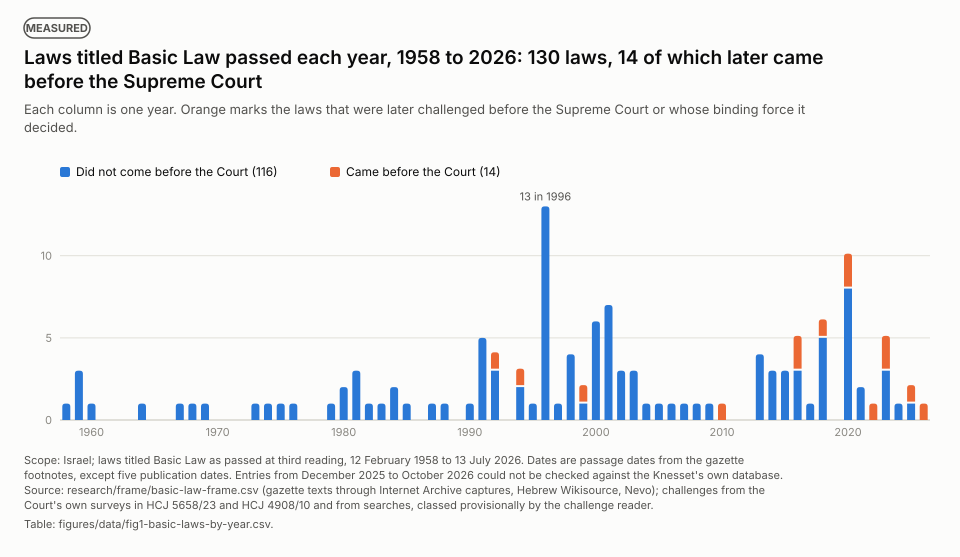
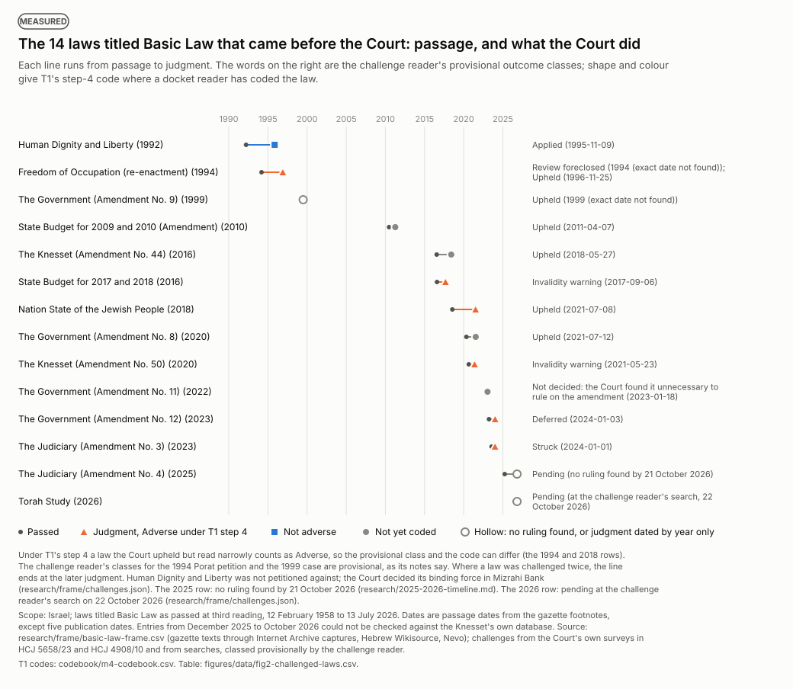
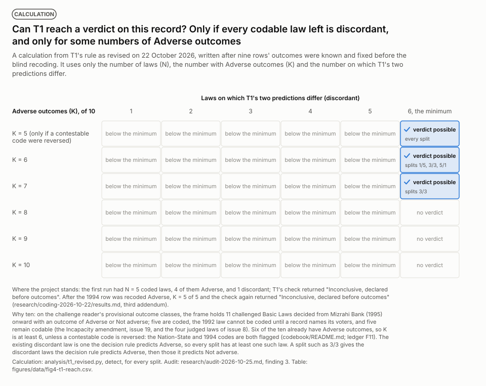
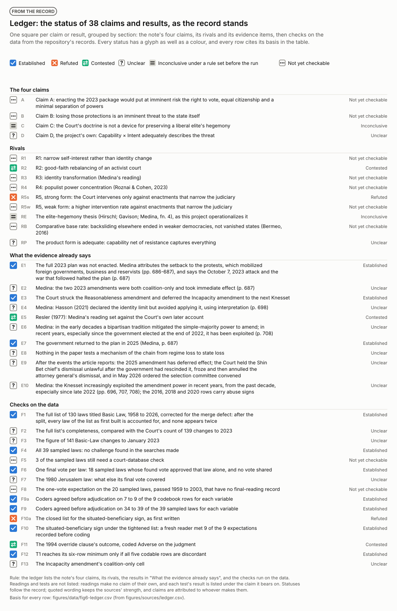
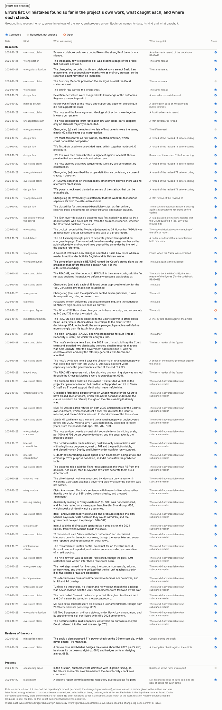

# Figures

Eight figures of the project: four measured from its data, one calculation from T1's rule, a ledger and an errors list drawn from its record, and one imagined figure. Each carries a label saying which. Measured and imagined are kept apart: the imagined figure alone is drawn in violet and says so in its title. Each figure comes in a light and a dark version.

Counts and statistics drawn from the data are computed by `analysis/make_figures.py` from the files each figure names. The ledger, the errors list and the jigsaw are curated by hand in `figures/sources/`, and every row there cites its basis. A few fixed values are set in the script, each with its source: the ten laws of figure 4, the first run's configuration, and the scope dates.

Every title, caption and label was tested against the sources by a separate reader before publication. Its findings, and what was changed in response, are in [corrections.md](corrections.md).

Rebuild them from the repository's root with `python3 analysis/make_figures.py`.

## Laws titled Basic Law passed each year, 1958 to 2026: 130 laws, 14 of which later came before the Supreme Court

<picture>
  <source media="(prefers-color-scheme: dark)" srcset="fig1-basic-laws-by-year-dark.svg">
  
</picture>

The full list of laws titled Basic Law, counted by year of passage. Scope: Israel; laws titled Basic Law as passed at third reading, 12 February 1958 to 13 July 2026. Dates are passage dates from the gazette footnotes, except five publication dates. Entries from December 2025 to October 2026 could not be checked against the Knesset's own database. Source: research/frame/basic-law-frame.csv (gazette texts through Internet Archive captures, Hebrew Wikisource, Nevo); challenges from the Court's own surveys in HCJ 5658/23 and HCJ 4908/10 and from searches, classed provisionally by the challenge reader.

Alt text: Column chart of the 130 laws titled Basic Law passed each year from 1958 to 2026. Most years before 1990 have none to two; the busiest year is 1996 with 13. 14 later came before the Court, challenged or ruled on as to their binding force; the first passed in 1992 and the last in 2026.

Table view

| Decade | Laws passed | Of them, came before the Court |
|---|---|---|
| 1950s | 4 | 0 |
| 1960s | 5 | 0 |
| 1970s | 5 | 0 |
| 1980s | 12 | 0 |
| 1990s | 34 | 3 |
| 2000s | 25 | 0 |
| 2010s | 23 | 4 |
| 2020s | 22 | 7 |

## The 14 laws titled Basic Law that came before the Court: passage, and what the Court did

<picture>
  <source media="(prefers-color-scheme: dark)" srcset="fig2-challenged-laws-dark.svg">
  
</picture>

The challenged laws, from passage to judgment. Outcome words are provisional; T1's step-4 code is shown where it exists.

Alt text: Timeline of the 14 laws that came before the Court, from passage to judgment, 1992 to 2026. 6 are coded Adverse under T1's step 4, 1 Not adverse, and 7 are not yet coded; for two, no ruling had been found when last checked, on 21 and 22 October 2026.

Table view

| Frame row | Law | Passed | Provisional outcome | T1 step-4 code |
|---|---|---|---|---|
| 34 | Human Dignity and Liberty | 1992-03-17 | Applied (1995-11-09) | Not adverse |
| 37 | Freedom of Occupation (re-enactment) | 1994-03-09 | Review foreclosed (1994 (exact date not found)); Upheld (1996-11-25) | Adverse |
| 60 | The Government (Amendment No. 9) | 1999-08-01 | Upheld (1999 (exact date not found)) | not yet coded |
| 86 | State Budget for 2009 and 2010 (Amendment) | 2010-06-22 | Upheld (2011-04-07) | not yet coded |
| 98 | The Knesset (Amendment No. 44) | 2016-07-20 | Upheld (2018-05-27) | not yet coded |
| 100 | State Budget for 2017 and 2018 | 2016-08-02 | Invalidity warning (2017-09-06) | Adverse |
| 108 | Nation State of the Jewish People | 2018-07-19 | Upheld (2021-07-08) | Adverse |
| 110 | The Government (Amendment No. 8) | 2020-05-07 | Upheld (2021-07-12) | not yet coded |
| 115 | The Knesset (Amendment No. 50) | 2020-08-24 | Invalidity warning (2021-05-23) | Adverse |
| 121 | The Government (Amendment No. 11) | 2022-12-27 | Not decided (moot/withdrawn/premature/in limine) (2023-01-18) | not yet coded |
| 123 | The Government (Amendment No. 12) | 2023-03-23 | Deferred (2024-01-03) | Adverse |
| 125 | The Judiciary (Amendment No. 3) | 2023-07-24 | Struck (2024-01-01) | Adverse |
| 128 | The Judiciary (Amendment No. 4) | 2025-03-27 | Pending (pending) | not yet coded |
| 130 | Torah Study | 2026-07-13 | Pending (pending) | not yet coded |

## The four warning signs Medina reports the Court uses, in the 39 sampled laws where no challenge was found

<picture>
  <source media="(prefers-color-scheme: dark)" srcset="fig3-signs-in-sample-dark.svg">
  
</picture>

How often the warning signs Medina reports appear in sampled Basic Laws where no challenge was found, with unknowns kept apart.

Alt text: Stacked bars for four warning signs, the beneficiary sign in two versions, across 39 sampled laws where no challenge was found. Alters, in a way others would not share, the position of the government or an officeholder in a matter live on the day it passed: 3 present, 36 absent, 0 not known; Addresses a specific interest of the government or an officeholder, on its text: 3 present, 36 absent, 0 not known; Takes effect within a year, and not only after the next election: 36 present, 3 absent, 0 not known; No opposition member voted for it at the final reading: 5 present, 8 absent, 26 not known; Expedited: final vote within 30 days of first reading, or a shortened committee stage: 18 present, 13 absent, 8 not known. All four signs can be scored on 12 laws: 1 show 1, 9 show 2, 2 show 3.

Table view

| Sign | Present | Absent | Not known |
|---|---|---|---|
| Alters, in a way others would not share, the position of the government or an officeholder in a matter live on the day it passed (situated; the primary version) | 3 | 36 | 0 |
| Addresses a specific interest of the government or an officeholder, on its text (named; the secondary version) | 3 | 36 | 0 |
| Takes effect within a year, and not only after the next election | 36 | 3 | 0 |
| No opposition member voted for it at the final reading | 5 | 8 | 26 |
| Expedited: final vote within 30 days of first reading, or a shortened committee stage | 18 | 13 | 8 |

## Can T1 reach a verdict on this record? Only if every codable law left is discordant, and only for some numbers of Adverse outcomes

<picture>
  <source media="(prefers-color-scheme: dark)" srcset="fig4-t1-reach-dark.svg">
  
</picture>

Where T1's rule can return a verdict, with ten coded laws. A calculation, not evidence.

Alt text: Grid of the configurations T1 could face with ten coded laws. A verdict is possible only with six discordant laws and six or seven Adverse outcomes, or five if a contestable Adverse code were reversed; with eight or more Adverse outcomes, or fewer than six discordant laws, no verdict is possible. The first run had five laws, four Adverse and one discordant, and could reach no verdict; nor could it after the 1994 row was recoded Adverse.

Table view

| K (Adverse of 10) | Discordant | Verdict possible | Passing splits |
|---|---|---|---|
| 5 | 1 | no | none |
| 5 | 2 | no | none |
| 5 | 3 | no | none |
| 5 | 4 | no | none |
| 5 | 5 | no | none |
| 5 | 6 | yes | 1/5; 2/4; 3/3; 4/2; 5/1; 6/0 |
| 6 | 1 | no | none |
| 6 | 2 | no | none |
| 6 | 3 | no | none |
| 6 | 4 | no | none |
| 6 | 5 | no | none |
| 6 | 6 | yes | 1/5; 3/3; 5/1 |
| 7 | 1 | no | none |
| 7 | 2 | no | none |
| 7 | 3 | no | none |
| 7 | 4 | no | none |
| 7 | 5 | no | none |
| 7 | 6 | yes | 3/3 |
| 8 | 1 | no | none |
| 8 | 2 | no | none |
| 8 | 3 | no | none |
| 8 | 4 | no | none |
| 8 | 5 | no | none |
| 8 | 6 | no | none |
| 9 | 1 | no | none |
| 9 | 2 | no | none |
| 9 | 3 | no | none |
| 9 | 4 | no | none |
| 9 | 5 | no | none |
| 9 | 6 | no | none |
| 10 | 1 | no | none |
| 10 | 2 | no | none |
| 10 | 3 | no | none |
| 10 | 4 | no | none |
| 10 | 5 | no | none |
| 10 | 6 | no | none |

## Where 46 coded Basic Laws sit on two axes of the sliding scale that Medina reads in the Court's approach

<picture>
  <source media="(prefers-color-scheme: dark)" srcset="fig5-sliding-scale-dark.svg">
  
</picture>

A geometry of the coded laws on the two axes of the sliding scale. The axes are ordered categories, not distances.

Alt text: A grid of deviation tier against coalition-only passage for 39 sampled laws where no challenge was found and 7 challenged Basic Laws coded under T1. Entrenches, coalition only: 1 with no challenge found, 0 Adverse, 0 Not adverse; None, coalition only: 1 with no challenge found, 0 Adverse, 0 Not adverse; Limited, coalition only: 3 with no challenge found, 2 Adverse, 0 Not adverse; Sharp, coalition only: 0 with no challenge found, 1 Adverse, 0 Not adverse; Entrenches, at least one opposition vote: 2 with no challenge found, 0 Adverse, 0 Not adverse; None, at least one opposition vote: 5 with no challenge found, 0 Adverse, 0 Not adverse; Limited, at least one opposition vote: 1 with no challenge found, 2 Adverse, 0 Not adverse; Entrenches, not known: 7 with no challenge found, 0 Adverse, 1 Not adverse; None, not known: 11 with no challenge found, 0 Adverse, 0 Not adverse; Limited, not known: 8 with no challenge found, 1 Adverse, 0 Not adverse.

Table view

| Deviation tier | Coalition-only passage | No challenge found | Challenged, Adverse | Challenged, Not adverse |
|---|---|---|---|---|
| Entrenches | Coalition only | 1 | 0 | 0 |
| None | Coalition only | 1 | 0 | 0 |
| Limited | Coalition only | 3 | 2 | 0 |
| Sharp | Coalition only | 0 | 1 | 0 |
| Entrenches | At least one opposition vote | 2 | 0 | 0 |
| None | At least one opposition vote | 5 | 0 | 0 |
| Limited | At least one opposition vote | 1 | 2 | 0 |
| Sharp | At least one opposition vote | 0 | 0 | 0 |
| Entrenches | Not known | 7 | 0 | 1 |
| None | Not known | 11 | 0 | 0 |
| Limited | Not known | 8 | 1 | 0 |
| Sharp | Not known | 0 | 0 | 0 |

## Ledger: the status of 38 claims and results, as the record stands

<picture>
  <source media="(prefers-color-scheme: dark)" srcset="fig6-ledger-dark.svg">
  
</picture>

The note's claims, rivals and evidence items, and the main checks on the data, each with its status and the basis for it.

Alt text: A list of 38 claims and results with their status: 10 established, 2 refuted, 3 contested, 12 unclear, 2 inconclusive under a rule set before the run, 9 not yet checkable. None of the four claims is established or refuted.

Table view

| ID | Section | Claim or result | Status | Basis |
|---|---|---|---|---|
| A | The four claims | Claim A: enacting the 2023 package would remove the institutional checks that make Israel a democracy | Not yet checkable | No test is proposed for it, and the package was not enacted in full (note: The question; Conjectures, C-A; What the evidence already says, items 1 to 3). |
| B | The four claims | Claim B: losing those checks threatens the state itself | Not yet checkable | Test T3 is designed but no data has been gathered (note: Proposed tests, T3). |
| C | The four claims | Claim C: the Court's doctrine is not a device for preserving a liberal elite's hegemony | Inconclusive under a rule set before the run | T1's first run: Inconclusive, declared before outcomes, on one discordant row against a minimum of six (research/coding-2026-10-22/results.md; change log (ab), (ag)). The rule was revised after nine rows' outcomes were known and fixed before the blind recoding (note: T1 as revised). |
| D | The four claims | Claim D, the project's own: Capability × Intent adequately describes the threat | Unclear | C-model's forbidding clause is recorded as refuted on the class reading of 'closed', adopted after the data under T4 (change log (p), (t), (ar)). C-model's other consequences are untested, so whether the product form fits is still open. |
| R1 | Rivals | R1: narrow self-interest rather than identity change | Not yet checkable | Test T2 has not been run (note: Rivals; Proposed tests, T2). |
| R2 | Rivals | R2: good-faith rebalancing of an activist court | Contested | Contradicted on the Reasonableness amendment by its legislative record coded without the judgment (codebook row 9); open on the Incapacity amendment, whose text supplies its own mechanisms and whose coalition-only cell is blank (row 8; issue 19). The Court's own indicators cannot decide it (note: Rivals; What this note does not claim; change log (ar)). |
| R3 | Rivals | R3: identity transformation (Medina's reading) | Not yet checkable | Test T2 has not been run (note: Rivals; Proposed tests, T2). |
| R4 | Rivals | R4: populist power concentration (Roznai & Cohen, 2023) | Not yet checkable | Test T2 has not been run (note: Rivals; Proposed tests, T2). |
| R5s | Rivals | R5, strong form: the Court intervenes only against enactments that narrow the judiciary | Refuted | Interventions against the 1969 financing law, the 2016 and 2020 budget measures and the 2018 Nation-State law, all coded targets_judiciary No by the blind coders (results.md, Exploratory results, step 15). |
| R5w | Rivals | R5, weak form: a higher intervention rate against enactments that narrow the judiciary | Not yet checkable | Its test needs at least four rows in each group; the judiciary-narrowing group has one (results.md, step 15). |
| RE | Rivals | The elite-hegemony thesis (Hirschl; Gavison; Medina, fn. 4), as this project operationalizes it | Inconclusive under a rule set before the run | T1 tests the project's version: an Adverse prediction where the coded direction is Illiberal (note: T1 as revised, Predictions). Its first run was inconclusive under its rule (results.md). Whether this meets the thesis as Hirschl states it is open (issue 21). |
| RB | Rivals | Comparative base rate: backsliding elsewhere ended in weaker democracies, not vanished states (Bermeo, 2016) | Not yet checkable | Decided by whether any T3 observable moves; T3 has no data (note: Rivals). |
| RP | Rivals | The product form is adequate: capability net of resistance captures everything | Unclear | Decided by instrument switching (T4). The forbidding clause is refuted on the class reading (change log (ar)), which does not show the product form adequate; the switching half of T4 has not been run. |
| E1 | What the evidence already says | The full 2023 plan was not enacted. Medina attributes the setback to the protests, which mobilized foreign governments, business and reservists (pp. 686-687), and says the October 7, 2023 attack and the war that followed halted the plan (p. 687) | Established | The fact: the frame holds two laws titled Basic Law from 2023 that Medina says aimed to facilitate the plan (p. 687; research/frame/basic-law-frame.csv, rows 123 and 125) and no 2023 law changing judicial appointments. The causes are Medina's account and are not tested here. |
| E2 | What the evidence already says | Medina: the two 2023 amendments were both coalition-only and took immediate effect (p. 687) | Unclear | The blind coders coded immediate effect Yes for both, Incapacity by the project's convention for a law with no commencement clause, after adjudication; and coalition-only Yes for Reasonableness, from a press tally (issue 15). Incapacity's coalition-only cell is blank (codebook/m4-codebook.csv; issue 19). |
| E3 | What the evidence already says | The Court struck the Reasonableness amendment and deferred the Incapacity amendment to the next Knesset | Established | HCJ 5658/23 (1 January 2024) and HCJ 2412/23 (3 January 2024), coded from the judgments by the docket reader (codebook/m4-codebook.csv; research/frame/basic-law-frame.csv). |
| E4 | What the evidence already says | Medina: Hasson (2021) declared the identity limit but avoided applying it, using interpretation (p. 698) | Unclear | Rests on the paper; the full judgment is unread (issue 12). Separately, the project's Adverse code for the Nation-State row is flagged as contestable (codebook/README.md). |
| E5 | What the evidence already says | Resler (1977): Medina's reading set against the Court's own later account | Contested | Medina reads it as the Court refraining from striking a re-enacted law (p. 694); the Court's later account is that Resler held the 1969 ratification law validly passed (change log (i)). The Hebrew judgment is unread (issue 2). |
| E6 | What the evidence already says | Medina: in the early decades a bipartisan tradition mitigated the simple-majority power to amend; in recent years, especially since the government elected at the end of 2022, it has been exploited (p. 708) | Unclear | Rests on the paper and is not checked here. The note's own wording of this item overstated p. 708 until change log (aq); see the errors list. |
| E7 | What the evidence already says | The government returned to the plan in 2025 (Medina, p. 687) | Established | The March 2025 amendment to Basic Law: The Judiciary is in the frame (research/frame/basic-law-frame.csv, row 128, passed 27 March 2025). |
| E8 | What the evidence already says | Nothing in the paper tests a mechanism of the chain from regime loss to state loss | Unclear | The note's reading of the paper (What the evidence already says, item 8); no second reader has checked it. |
| E9 | What the evidence already says | After the article's cut-off: the 2025 amendment has deferred effect; the Court held the Shin Bet chief's dismissal unlawful after the government had rescinded it, froze and then annulled the attorney general's dismissal, and in May 2026 ordered the selection committee convened | Unclear | From press reports in research/2025-2026-timeline.md, which applies them to the note's evidence item 9; the judgments are not read. The note's own wording of item 9 overstated the timeline until change log (aq); see the errors list. |
| E10 | What the evidence already says | Medina: the Knesset increasingly exploited the amendment power in recent years, from the past decade, especially since late 2022 (pp. 696, 707, 708); the 2016, 2018 and 2020 rows carry abuse signs | Unclear | Rests on the paper, and on codebook rows 5 to 7 for the signs and outcomes. On it, the actor reading's prediction of near-zero threat before January 2023 fails (note: evidence item 10; change log (ar)). |
| F1 | Checks on the data | The full list of 130 laws titled Basic Law, 1958 to 2026, corrected for the merge defect: after the split, every law of the list as first built is accounted for, and none appears twice | Established | research/frame/README.md, The defect and its correction; analysis/frame_merge_check.py; change log (al). This is not a check of completeness (row F2). |
| F2 | Checks on the data | The full list's completeness, compared with the Court's count of 139 changes to 2023 | Unclear | 122 laws and 140 or 141 changes bracket the Court's 139, and the Court's counting rule is not stated, so the comparison neither confirms nor refutes completeness (research/frame/README.md). |
| F3 | Checks on the data | The figure of 141 Basic-Law changes to January 2023 | Unclear | No script produces it, how it was first counted is not recorded, and under the stated rule it recomputes as 140 (research/audit-2026-10-25.md, finding 6; issue 20). |
| F4 | Checks on the data | All 39 sampled laws: no challenge found in the searches made | Established | Two docket readers for each draw (research/frame/verification-a.json, verification-b.json, verification-redraw-a.json, verification-redraw-b.json); the searches did not reach the court database. |
| F5 | Checks on the data | 3 of the sampled laws still need a court-database check | Not yet checkable | Basic Law: Referendum (2014) and the June and July 2020 State Economy amendments; the court database is unreachable (issue 6). |
| F6 | Checks on the data | One final vote per law: 18 sampled laws whose found vote approved that law alone, and no vote shared | Established | codebook/comparison-sample.csv, final_vote columns; research/coding-sample-2026-10-22/README.md, The one-vote check. |
| F7 | Checks on the data | The 1980 Jerusalem law: what else its final vote covered | Unclear | The vote is found but its coverage of other laws is not established (research/coding-sample-2026-10-22/README.md). |
| F8 | Checks on the data | The one-vote expectation on the 20 sampled laws, passed 1959 to 2003, that have no final-reading record | Not yet checkable | No archived plenum record survives for them; the Knesset's site is unreachable (issue 6). |
| F9a | Checks on the data | Coders agreed before adjudication on 7 to 9 of the 9 codebook rows for each variable | Established | research/coding-2026-10-22/results.md, Agreement between the coders. |
| F9 | Checks on the data | Coders agreed before adjudication on 34 to 39 of the 39 sampled laws for each variable | Established | research/coding-sample-2026-10-22/assembly-summary-redraw.json, agreement. |
| F10a | Checks on the data | The closed list for the situated-beneficiary sign, as first written | Refuted | A reader met 6 of the 9 expectations recorded before coding; three enactments were coded Yes on single-instance and sunset clauses, which change log (ad) records as a defect in the list (results.md, Addendum). |
| F10 | Checks on the data | The situated-beneficiary sign under the tightened list: a fresh reader met 9 of the 9 expectations recorded before coding | Established | results.md, Second addendum; change log (ae), (af). |
| F11 | Checks on the data | The 1994 override clause's outcome, coded Adverse on the judgment | Contested | Coded at medium confidence, with an alternative reading recorded (results.md, Third addendum; change log (ag)). |
| F12 | Checks on the data | T1 reaches its six-row minimum only if all five codable rows are discordant | Established | A calculation from T1's rule with analysis/t1_revised.py, on the frame's provisional outcome classes (research/audit-2026-10-25.md, finding 3). |
| F13 | Checks on the data | The Incapacity amendment's coalition-only cell | Unclear | Blank; the Open Knesset vote tables may hold the vote (issue 19). |

## Errors list: 42 mistakes found so far in the project's own work, what caught each, and where each stands

<picture>
  <source media="(prefers-color-scheme: dark)" srcset="fig7-errors-dark.svg">
  
</picture>

The mistakes found so far in the project's own work, with what caught each and where each stands.

Alt text: A list of 42 errors: 38 in the research, 2 in reviews and 2 in process. 38 are corrected, 3 recorded and not undone, and 1 open.

Table view

| # | Date | Kind | What was wrong | What caught it | Corrected in | State |
|---|---|---|---|---|---|---|
| 1 | 2026-10-21 | overstated claim | Several codebook cells were coded No on the strength of the article's silence. | An adversarial reread of the codebook README | Change log, 2026-10-21 (later): the cells were made provisional, citing the research notes, or left blank. | Corrected |
| 2 | 2026-10-21 | wrong citation | The Incapacity row's expedited cell was cited to a page of the article that does not contain it. | The same reread | Change log, 2026-10-21 (later). | Corrected |
| 3 | 2026-10-21 | wrong classification | The change log records that three codebook rows are not Basic Law enactments; the codebook now marks two as ordinary statutes, so the recorded count may itself be imprecise. | The same reread | Change log, 2026-10-21 (later): an enactment_type column was added. | Corrected |
| 4 | 2026-10-21 | overstated claim | The first-day M4 table presented the six signs as a list the Court states as a set. | The same reread | Change log, 2026-10-21 (later); M4 is superseded, and checking the signs against the judgments is issue 13. | Recorded, not undone |
| 5 | 2026-10-21 | wrong date | The Shafir row carried the wrong year. | The same reread | Change log, 2026-10-21 (later): corrected to 2020. | Corrected |
| 6 | 2026-10-22 | design flaw | Deviation-tier values were assigned with knowledge of the outcomes they were meant to predict. | A second adversarial reread | Change log (c); all nine rows recoded by blind coders (change log (ab)). | Corrected |
| 7 | 2026-10-22 | misread source | Resler was offered as the note's one supporting case; on checking, it did not support the claim. | A verification pass on Westlaw and public sources | Change log (i); the note, What this note does not claim. The Hebrew judgment is still unread (issue 2). | Corrected |
| 8 | 2026-10-22 | overstated claim | The note said the form signs and ideological direction move together in every current row. | A fourth adversarial reread | Change log (o). | Corrected |
| 9 | 2026-10-22 | unsupported claim | The note credited the 1969 ratification law with cross-party support; only an absolute majority is recorded. | A fifth adversarial reread | Change log (r). | Corrected |
| 10 | 2026-10-22 | wrong statement | Change log (p) said the note's two lists of instruments were the same; matrix M2's list leaves out interpretation. | The fifth reread | Change log (t) corrects the statement. M2 itself still has no interpretation row. | Recorded, not undone |
| 11 | 2026-10-22 | design flaw | T1's must-fail control, as first written, shuffled direction, which could not null the comparison. | A reread of the revised T1 before coding | Change log (w): the control shuffles outcomes and a must-detect check was added. | Corrected |
| 12 | 2026-10-22 | design flaw | T1's first draft used two one-sided tests, which together made a 0.10 procedure. | A reread of the revised T1 before coding | Change log (w): one two-sided test at 0.05. | Corrected |
| 13 | 2026-10-22 | design flaw | T1's test was then miscalibrated: a sign test against one half, then a p-value that assumed a null centred on zero. | Rereads of the revised T1 before coding | Change log (x), (y): an exact permutation test with a two-sided p from the smaller tail. | Corrected |
| 14 | 2026-10-22 | overstated claim | The note claimed that rows targeting the judiciary are concordant by construction. | A reread of the revised T1 before coding | Change log (x): the claim was withdrawn. | Corrected |
| 15 | 2026-10-22 | wrong statement | Change log (w) described the scope definition as containing a consent clause; it does not. | A reread of the revised T1 before coding | Change log (y). | Corrected |
| 16 | 2026-10-22 | overstated claim | A README sentence on the Incapacity amendment claimed there was no alternative mechanism. | A reread of the revised T1 before coding | Change log (y). | Corrected |
| 17 | 2026-10-22 | design flaw | T1's power check used planted extremes of the statistic that can be unattainable. | A reread of the revised T1 before coding | Change log (z): the check uses the attainable extremes under the exact null. | Corrected |
| 18 | 2026-10-22 | wrong statement | Change log (z) reversed (y)'s statement that the weak R5 test cannot separate R5 from the elite-interest rival. | A fifth reread of the revised T1 | Change log (aa): (y)'s statement is reinstated and the reversal withdrawn. | Corrected |
| 19 | 2026-10-22 | design flaw | The closed list for the situated-beneficiary sign, as first written, reached three enactments on single-instance and sunset clauses. | The first circumstances reader's coding against expectations recorded before coding | Change log (ad), (ae): the list was tightened, and a fresh reader recoded the nine rows (change log (af)). | Corrected |
| 20 | 2026-10-22 | cell coded without the source | The 1994 override clause's outcome was first coded Not adverse by a docket reader who could not tell, from the sources it reached, whether the Court had qualified the clause. | A flag at assembly: Medina reports that the Court qualified it (pp. 697-698; results.md) | Change log (ag): a second docket reader read HCJ 4676/94 in full and recoded it Adverse. | Corrected |
| 21 | 2026-10-22 | wrong date | The docket recorded the Meatrael judgment as 26 November 1996; it was 25 November, and 26 November is the date of a press report. | The second docket reader's reading of the official report | Change log (ag). | Corrected |
| 22 | 2026-10-22 | build defect | The full list merged eight pairs of separately titled laws printed on one gazette page. The same build read a one-digit page number as the publication date, and ordered laws passed the same day by the text of the gazette reference. | A coder who found that a sampled row held two laws | Change log (al): the frame was corrected to 130 rows and the sample redrawn. | Corrected |
| 23 | 2026-10-22 | wrong count | A count of 159 Basic-Law changes counted a Basic Law twice where a reader listed it under both its English and its Hebrew name. | Found when the frame was corrected | Change log (al); research/frame/README.md: corrected to 137 for the list as first built. | Corrected |
| 36 | 2026-10-22 | sequencing lapse | In the first run, outcomes were delivered with litigation timing, so the table's assembler saw them before the detectability check was computed. | Disclosed in the run's own report | Change log (ab); results.md, Roles; the sequencing rule was made explicit in T1. | Recorded, not undone |
| 37 | 2026-10-22 | leaked path | A coder's report committed to the repository quoted a local file path. | Not recorded; issue 18 says commits are now checked for such paths | Old commit 0c53bc7 shortened it; the history rewrite of 25 October replaced it in fc6b81b, the rewritten d7d2fe1 (change log (ao); issue 18). | Corrected |
| 25 | 2026-10-25 | wrong attribution | The comparison sample's README named the Court's stated signs as the prediction that differs from the decision rule; it is the elite-interest reading. | The audit against the evidence | Change log (ap), commit 8e730e9. | Corrected |
| 26 | 2026-10-25 | overstated claim | The README, and the codebook README in the same words, said the first run was declared inconclusive before any outcome was looked at. | The audit (for the README); the fresh reader of the figures (for the codebook README) | Change log (ap), commit 8e730e9, corrects the README; change log (aq) corrects the codebook README. | Corrected |
| 27 | 2026-10-25 | overstated claim | Change log (am) said each of 19 found votes approved one law; for the 1980 Jerusalem law that is not established. | The audit | Change log (ap). | Corrected |
| 28 | 2026-10-25 | wrong count | Change log (am) said the adjudicator settled seven questions; it was three questions, ruling on seven rows. | The audit | Change log (ap). | Corrected |
| 29 | 2026-10-25 | stale text | Passages written before the addenda to results.md, and the codebook README's sign counts, still read as current. | The audit | Change log (ap): dated pointers and updated counts. | Corrected |
| 30 | 2026-10-25 | unscripted figure | The 141 and 137 Basic-Law change counts have no script, and recompute as 140 and 136 under the stated rule. | The audit | Open (issue 20). | Open |
| 34 | 2026-10-25 | misapplied check | The audit's plan proposed T1's power check on the 39-row sample, which never enters T1's main test. | Caught during the audit | research/audit-2026-10-25.md, A correction to the plan for this audit. | Corrected |
| 31 | 2026-10-27 | misdated attribution | The README said critics objected to the Court's power to strike down Basic Laws, where Medina dates the critique to the Court's 1995 decision (p. 684, footnote 4); the same paragraph paraphrased Medina more strongly than his text in four places. | A line-by-line check against the article | Commit c9eb28b; issue 21, How the README states it. | Corrected |
| 32 | 2026-10-27 | omission | The plain-language README opening dropped the formula Threat = Capability × Intent, on which the analyses rest. | The author | Commit 137f8ad. | Corrected |
| 35 | 2026-10-27 | overstated claim | A review note said Medina hedges the claims about the 2023 plan's aim; he states its purpose outright (p. 684) and hedges on its underlying aim (p. 685). | A line-by-line check against the article | Issue 21, About the published paper, point 1; commit c9eb28b gives both in the README. | Corrected |
| 24 | 2026-10-28 | overstated claim | The note's evidence item 9 and the 2025 row of matrix M1 say the Court froze and annulled two dismissals; the cited timeline records that one was held unlawful after the government had rescinded it, with no operative order, and only the attorney general's was frozen and annulled. | The fresh reader of the figures | Change log (aq). | Corrected |
| 33 | 2026-10-28 | overstated claim | The note's evidence item 6 says the simple-majority amendment power was exploited only from late 2022; p. 708 says in recent years, especially since the government elected at the end of 2022. | A check of the figures' premises against the article | Change log (aq). | Corrected |
| 38 | 2026-10-28 | loaded word | The README's glossary said a law showing one warning sign was rushed through the Knesset; Medina's word is expedited (p. 699). | The fresh reader of the figures | Change log (aq). | Corrected |
| 39 | 2026-10-28 | overstated claim | The outcome table qualified the revised T1's Refuted verdict as the project's operationalization but credited a Supported verdict to Claim C itself, so T1 could support Medina but never refute him. | The round-1 adversarial review, substance reader | Change log (ar). | Corrected |
| 40 | 2026-10-28 | unfalsifiable term | C-model's forbidding clause turned on what it means for the Court to have closed an instrument, which was never defined; undefined, the clause could not be refuted, though on the class reading it already was. | The round-1 adversarial review, substance reader | Change log (ar). | Corrected |
| 41 | 2026-10-28 | overstated claim | Rival R2 was declared refuted on both 2023 amendments by the Court's own indicators, which cannot test a rival that distrusts the Court's reasons, and the refutation was said to stand whatever the tests show. | The round-1 adversarial review, substance reader | Change log (ar). | Corrected |
| 42 | 2026-10-28 | overstated claim | Matrix M1 said intent was low and the amendment power undiscovered before late 2022; Medina says it was increasingly exploited in recent years, from the past decade (pp. 696, 707, 708). | The round-1 adversarial review, substance reader | Change log (ar). | Corrected |

## Imagined jigsaw: how the project's questions might fit around its ideal

<picture>
  <source media="(prefers-color-scheme: dark)" srcset="fig8-jigsaw-dark.svg">
  
</picture>

Imagined. Not a result. The project's questions as pieces around its ideal, with three conjectural threads.

Alt text: An imagined figure, drawn in violet. Seven pieces surround an empty centre, the project's ideal: Would the 2023 package remove the institutional checks that make Israel a democracy? (half-filled, 2 of 4 items established or refuted); Does the threat reach the state itself? (empty and tilted, 0 of 3 items established or refuted); Does the Court follow its warning signs or the laws' politics? (half-filled, 5 of 10 items established or refuted); Does Capability × Intent fit this case? (half-filled, 1 of 4 items established or refuted); What was the 2023 plan for? (empty and tilted, 0 of 4 items established or refuted); Is the Court acting for its own power? (half-filled, 1 of 2 items established or refuted); Is the record of Basic Laws complete and correct? (half-filled, 3 of 8 items established or refuted). Three numbered threads join pieces; each is captioned below with its premises and a conjecture.

Table view

| Piece | Question | Items | Settled | Drawn as |
|---|---|---|---|---|
| PA | Would the 2023 package remove the institutional checks that make Israel a democracy? | A, E1, E2, E3 | 2 of 4 | half-filled |
| PB | Does the threat reach the state itself? | B, RB, E8 | 0 of 3 | empty and tilted |
| PC | Does the Court follow its warning signs or the laws' politics? | C, RE, E4, E5, F9a, F9, F10a, F10, F11, F12 | 5 of 10 | half-filled |
| PD | Does Capability × Intent fit this case? | D, RP, E7, E10 | 1 of 4 | half-filled |
| PP | What was the 2023 plan for? | R1, R2, R3, R4 | 0 of 4 | empty and tilted |
| P5 | Is the Court acting for its own power? | R5s, R5w | 1 of 2 | half-filled |
| PF | Is the record of Basic Laws complete and correct? | F1, F2, F3, F4, F5, F6, F7, F8 | 3 of 8 | half-filled |

Thread 1 (PF to PC). Premises: 14 of the 130 laws titled Basic Law came before the Court, challenged or ruled on as to their binding force (research/frame/basic-law-frame.csv), and T1 needs six laws on which its two predictions differ (note, T1 as revised, step 7). Conjecture: Perhaps the Court's own record is too small to tell doctrine from politics, and a test might need other courts' records.

Thread 2 (PF to PD). Premises: Laws titled Basic Law were passed at 4 in 1958 and 1959, then 5, 5 and 12 in the next three decades, 34, 25 and 23 in the three after that, and 22 in the 2020s to July 2026 (research/frame/basic-law-frame.csv). Medina writes that a bipartisan tradition once mitigated the simple-majority power to amend, and that in recent years, especially since the government elected at the end of 2022, it has been exploited (p. 708). Conjecture: Perhaps routine amendment is part of a standing vulnerability, the structural reading's concern, that one actor's capability times intent might miss.

Thread 3 (PP to PC). Premises: Medina's substance-level reply to the elite critique rests on the 2023 plan's aims (pp. 684-685), and test T2 is designed to catalogue what the government did with its powers (note, Proposed tests, T2). Conjecture: Perhaps T2's results might bear on Claim C as well as on the rivals.

